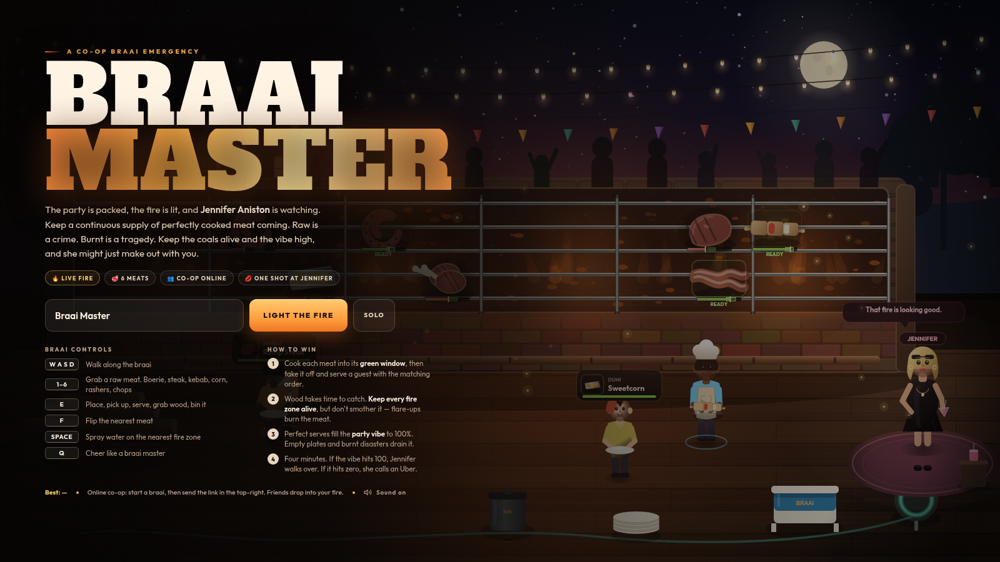
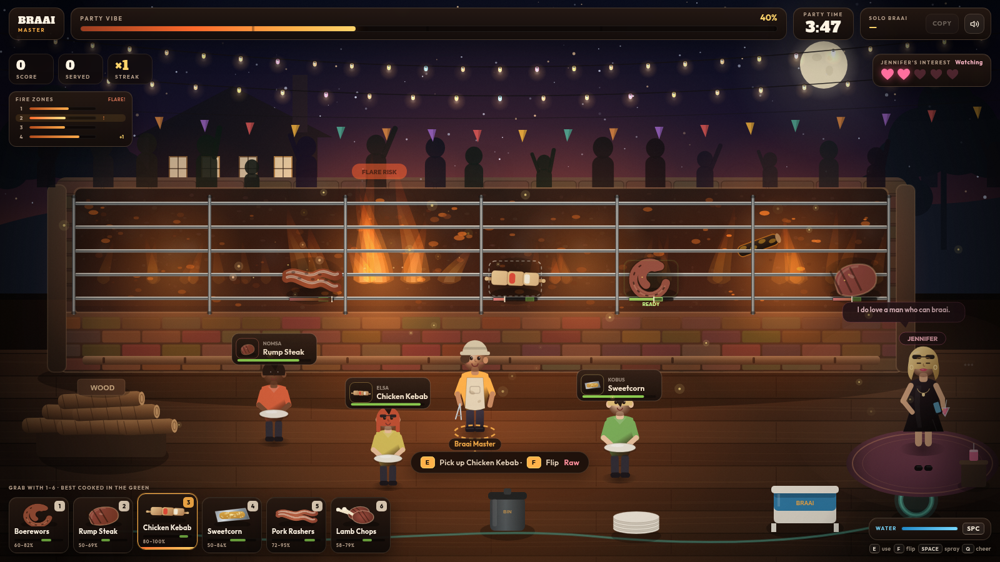
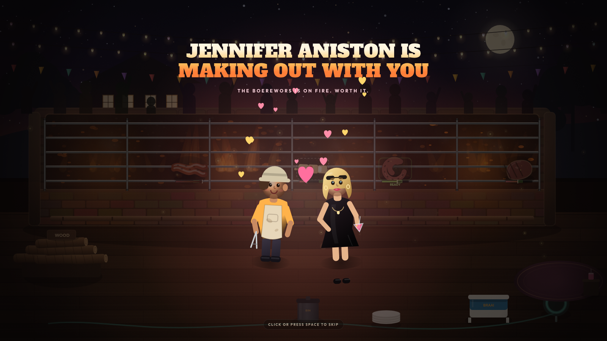

# Braai Master — Jennifer's Party

A browser-based co-op braai survival game. You are the braai master at the party of the year. Keep a continuous supply of perfectly cooked meat coming, keep four fire zones alive, and keep the vibe high enough that **Jennifer Aniston** walks over. Raw is a crime. Burnt is a tragedy.





## Play

No build step. Serve the folder and open it in a browser:

```bash
./serve.sh          # http://localhost:8080
# or
python3 -m http.server 8080
```

You can also open `index.html` directly for solo play, but a local server is recommended (and needed for a shareable multiplayer link on your LAN).

Tested in Chromium. Uses Google Fonts and [PeerJS](https://peerjs.com/) from CDNs; if PeerJS cannot load, the game falls back to solo.

## Controls

| Input | Action |
| --- | --- |
| `W A S D` / arrows | Walk along the braai |
| `1` – `6` | Grab a raw meat (or click/tap a meat card) |
| `E` | Context action: place, pick up, serve, grab wood, toss wood, bin |
| `F` | Flip the nearest meat |
| `SPACE` (hold) | Spray water on the nearest fire zone |
| `Q` | Cheer |
| `M` | Mute / unmute |
| `ENTER` / `SPACE` on results | Another braai |

**Touch:** landscape only. Joystick to move, tap a meat card to grab, `E` / `FLIP` / `💧` buttons to cook.

## Multiplayer (optional)

Start a braai, then use **COPY** in the top-right (or copy the `#ABCDE` code in the address bar) and send the link to friends. They open the link, enter a name, and join the same live braai. The host's browser simulates the match; friends can drop in and cook together. If the host leaves, guests continue solo with the current state.

The **Solo** button skips networking entirely.

## How it works

- **Cooking.** Every meat has a green doneness window. Flip at the right time to cook both sides; the gauge under each item shows the target. Take it off with `E` and serve it to a guest whose order matches.
- **Six meats.** Boerewors, rump steak, chicken kebab, sweetcorn kernels, pork rashers, lamb chops — each with a different ideal window and cook speed.
- **Fire.** Four zones, each with its own coal bed. Wood takes about 6 seconds to catch and turn into coals. Too little wood and the zone goes cold; too much and it flares up, charring everything above it. Spray flare-ups with water. The fire-zone panel on the left shows coal, flare warnings and wood currently catching.
- **Vibe.** Perfect serves fill the party vibe; raw, overcooked and ruined plates drain it, as do hungry guests who give up and leave. Reach 100% within four minutes to trigger the Jennifer cutscene. Hit zero and the party is over.
- **Jennifer's interest** tracks the vibe. Her quotes and mood change as the party goes better or worse.

## Tech

- `index.html` — layout, HUD, menu, results, responsive/touch styling.
- `game.js` — canvas renderer, simulation, procedural WebAudio soundtrack and effects, PeerJS host-authoritative networking.
- No dependencies to install. PeerJS 1.5.4 and Google Fonts are loaded from CDNs.

The multiplayer transport is adapted from the approach used in [Steelball](../steelball/): a public PeerJS broker handles the WebRTC handshake, the first browser with a room code hosts, and the host relays authoritative state at 20 Hz. Client movement is locally predicted and softly reconciled.

<details>
<summary>Spoiler: the win cutscene</summary>



</details>
